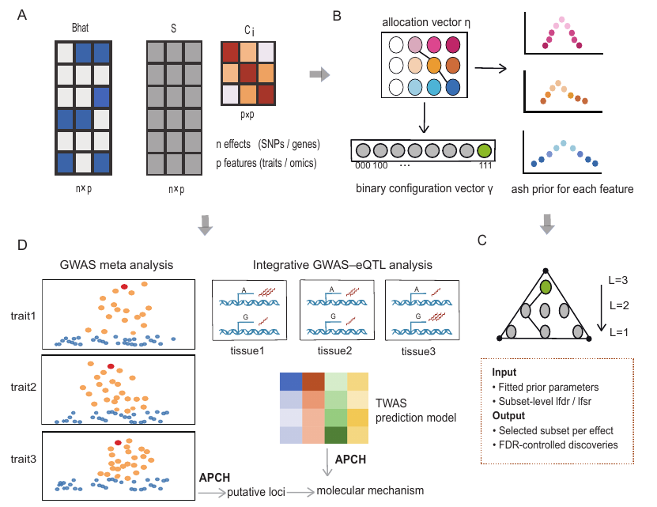

# APCH

**Adaptive Partial Conjunction Hypothesis**: which features does each effect act on jointly?

Given effect estimates for many units (SNPs, genes) across several features
(traits, tissues), APCH reports for each unit the largest subset of features
that are **all** non-null, with a subset-level local false discovery rate
(lfdr) and local false sign rate (lfsr).

- Each feature's effect sizes get a flexible adaptive shrinkage (ash) prior.
- The joint prior learns how effect sizes are shared among jointly affected features.
- Estimation errors may be correlated across features, as with overlapping GWAS samples.

<p align="center">
  
</p>

## Installation

```r
# install.packages("remotes")
remotes::install_github("colinyuxin/APCH", build_vignettes = TRUE)
```

The package compiles C++ code, so you need Rtools on Windows or the Xcode
command line tools on macOS.

## Quick start

```r
library(apch)

set.seed(1)
n <- 5000; p <- 3
gamma <- matrix(rbinom(n * p, 1, 0.05), n, p)   # effects on single traits
gamma[runif(n) < 0.05, ] <- 1                    # effects on all three traits
B <- gamma * matrix(rnorm(n * p, sd = 3), n, p)
Bhat <- B + matrix(rnorm(n * p), n, p)
colnames(Bhat) <- c("T2D", "FI", "FPG")

fit <- apch(Bhat, S = matrix(1, n, p))
fit
#> APCH fit (apch_s): 5000 effects x 3 features
#> 404 effects selected by lfsr at alpha = 0.05
#> Subset size L: 3:38  2:49  1:317

head(fit$calls, 3)
#>   effect L         lfsr     subset subset01
#> 1  e2093 3 0.0002709706 T2D|FI|FPG    1|1|1
#> 2  e2518 3 0.0007648754 T2D|FI|FPG    1|1|1
#> 3  e1456 3 0.0016401242 T2D|FI|FPG    1|1|1
```

For your own data, `Bhat` and `S` are n × p matrices of estimates and
standard errors, and `C` is the p × p correlation of estimation errors, or a
list with one such matrix per effect:

```r
fit <- apch(Bhat, S, C = C, workers = 4)
```

## Functions

`apch()` runs the whole analysis. Each stage is also available on its own, so
a fit can be reused without refitting.

| Function | What it does |
| --- | --- |
| `apch()` | Full analysis: marginal fit, joint fit, subset selection |
| `apch_marginal()` | Adaptive shrinkage fit for each feature |
| `apch_joint()` | Joint prior across features (APCH-s by default) |
| `apch_lfdr()`, `apch_lfsr()` | Subset-level lfdr and lfsr for any subsets |
| `apch_select()` | Level-by-level selection by lfsr or lfdr at a given level |

A longer example, including a check of the false discovery proportion
against the simulated truth, is in the vignette:

```r
vignette("apch-intro", package = "apch")
```

APCH models all 2^p null/non-null configurations, so it is meant for a
moderate number of features (up to about 8).

## Citation

Li Y, Lu Z, Lin X. Adaptive Partial Conjunction Hypothesis: Identifying
Pleiotropy Across Heterogeneous Effect Units.

## License

GPL (>= 3)
